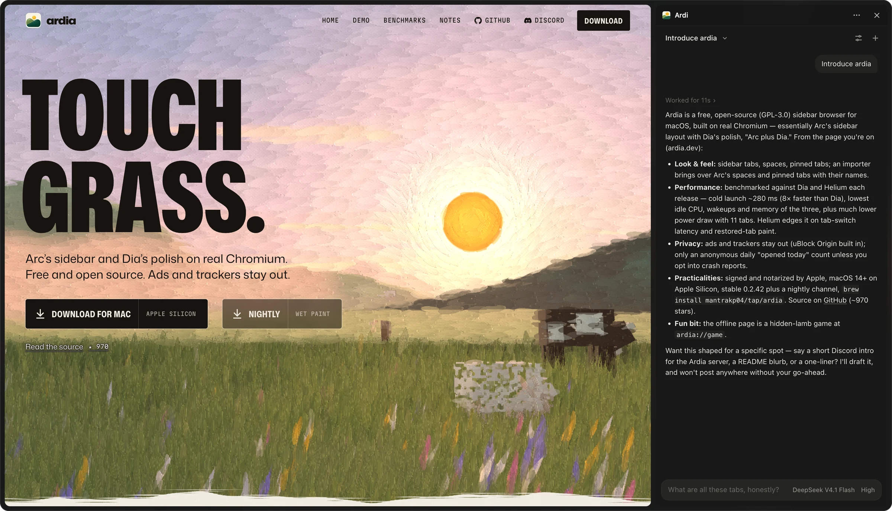

<p align="center"><picture><source media="(prefers-color-scheme: dark)" srcset=".github/assets/title-dark.svg"></picture></p>

<p align="center"><strong>Pi, in your Ardia's side panel.</strong></p>

<p align="center">A chat panel for the <a href="https://github.com/mantrakp04/ardia">Ardia</a> browser that runs your local <a href="https://github.com/earendil-works/pi">Pi</a> coding agent.<br>Ask about the page you're on, sort out your tabs, or have Pi click, type and read its way through the web.</p>

<p align="center"><a href="#quick-start">Quick start</a> · <a href="#make-it-yours">Make it yours</a> · <a href="#contributing">Contributing</a> · <a href="LICENSE">MIT</a></p>

<p align="center"></p>

<br>

## Features

- **Now supports Chrome.** The same Ardi panel, in the Chrome you already use. Works with your existing tabs and signed-in accounts. [Get started →](#chrome-support)
- **Works across your tabs.** It can list, read and open tabs, look at the images on them, and run anything else through `ardia exec`.
- **Mention tabs with @.** Type `@` to pick an open tab; it goes into your message as a chip, and Pi reads it.
- **Keeps working when the panel is closed.** Pi lives in the background, not in the panel.
- **Every chat is a Pi session.** Switch chats and pick up exactly where you left off.
- **Isolated.** It runs with its own prompt, tools and skills, separate from your own Pi setup.

## How it works

```
side panel ⇄ background worker ⇄ native messaging ⇄ bridge (bun) ⇄ pi --mode rpc
```

Extensions can't start local programs, so a small bridge runs Pi and streams its events back. Pi's session files under `~/.pi/agent/sessions` are the record of each chat; the extension only keeps the chat list. One build puts all of it in `dist/ardia/`: the extension, the bridge and Pi's setup. Chrome gets its own copy in `dist/chrome/`.

## Quick start

You need [bun](https://bun.sh) and Pi on macOS or Linux. In Ardia, turn on **Settings → Advanced → Command Line → Let the ardia command control Ardia**.

### Download a release

Download `ardi-ardia-<version>.zip` from [Releases](https://github.com/YishenTu/ardi/releases), extract it, and open a terminal in the extracted folder:

```sh
bun install-host.ts ardia
```

In Ardia, open **Settings → Extensions → Add extensions → Load unpacked extension**, select the folder printed by the installer, and open Ardi from the extensions menu. You can delete the download afterwards. To upgrade, run the installer from the new release and reload the extension.

### Build from source

```sh
git clone https://github.com/YishenTu/ardi.git
cd ardi
bun install
bun run build
bun run host:install ardia
```

In Ardia, open **Settings → Extensions → Add extensions → Load unpacked extension**, pick `dist/ardia/`, and open Ardi from the extensions menu. Keep the repository in place; this installation runs from its built files.

## Make it yours

| What | Where |
| --- | --- |
| **Prompt** | `src/agent/system-prompt.md` is Pi's entire system prompt. |
| **Tools** | Ardia tools are in `src/targets/ardia/agent/extension/`; Chrome tools are in `src/targets/chrome/agent/extension/`. |
| **Your instructions** | Write them in `~/.ardi/AGENTS.md`; they apply from your next new chat. |
| **Skills** | Drop them in `~/.ardi/.agents/skills/`; they show up in your next new chat. |
| **Which Pi** | Set the Pi CLI path in Settings (the sliders button); leave it empty to use the Pi `host:install` found. |

Rebuild after editing the prompt or tools, then reload the extension.

## Chrome support

Download and extract `ardi-chrome-<version>.zip` from [Releases](https://github.com/YishenTu/ardi/releases), then run `bun install-host.ts chrome` inside it. Requires Bun and Pi, as above.

Open `chrome://extensions`, enable **Developer mode**, choose **Load unpacked**, and select the folder printed by the installer. For a source build, run `bun run host:install chrome` and load `dist/chrome/` instead.

Both versions share instructions and skills in `~/.ardi/`; chats and settings stay separate. Chrome's debugging banner can remain after a response until you cancel control or restart Ardi. Persistent userscripts are Ardia-only.

## Contributing

Contributor and agent guidelines are in [`AGENTS.md`](AGENTS.md). The bridge's Pi runtime is adapted from [Claudian](https://github.com/YishenTu/claudian).

## License

[MIT](LICENSE)
